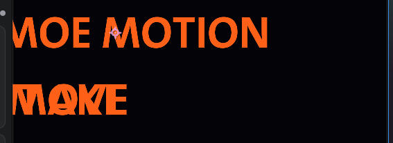

# Retest — MOE Motion AI 1.0.1 in After Effects, by hand

| | |
|---|---|
| After Effects | **26.5.3 (Build 9)** — Help › About; Diagnostics reads `26.5.3x9` |
| MOE Motion AI | **1.0.1** — What's new in 1.0.1 · Settings › Updates "MOE Motion AI 1.0.1" · Diagnostics › Host module `1.0.1` |
| Date | 2026-11-22, 11:40 – 13:10 local |
| Project | `Desktop\MOE Manual Test\MOE Manual Test.aep`, new comp `MOE Retest 1.0.1` (1920×1080, 25 fps, 10 s) |
| Branch | `retest/1.0` from `origin/main` `4fdb1f8` |
| Checks before testing | `npm install`, `npm run check` → ES3-clean · contrast 108/108 · 677 tests, 0 fail |

**How 1.0.1 got onto the machine.** The installed panel was 0.99.5, so (with After Effects closed — it was not
running) `extension\*` was copied over `%APPDATA%\Adobe\CEP\extensions\tv.madtomato.moe.motionai\`.
**`extension\.debug` was deliberately left out**: it is in the repository and it opens a remote-debugging port
(`<Host Name="AEFT" Port="8099"/>`), which the release rules forbid in an installed build. A literal "copy
`extension\*`" would have installed it.

---

## 1. The pie's search — everything asked for works

| # | Step | What happened | Verdict |
|---|---|---|---|
| 1.1 | Open the pie, release in the centre | Opens at the pointer, **stays open**, centre is the search box (focused), 8 numbered slices around it, ✕ top-right | **WORKS** |
| 1.1 | ✕ cancels | Pie closed; Edit menu still read **"Undo New Text Layer"** — nothing ran | **WORKS** |
| 1.1 | Esc cancels | Pie closed, nothing ran | **WORKS** |
| 1.2 | `gauss` → *Gaussian Blur · Effect* → Enter | Effect on the selected text layer (visibly blurred, `fx` badge on). Edit menu: **"Undo MOE: Gaussian Blur"**; **one** Ctrl+Z removed it | **WORKS** |
| 1.3 | `gauss` → **Ctrl+Enter** | New adjustment layer **"Gaussian Blur Adjustment"** above the selection, Gaussian Blur on it (Blurriness 25.0). **One** Ctrl+Z removed layer + effect | **WORKS** |
| 1.4 | An After Effects animation preset → Enter | `fade` listed **Fade In · Animation preset · Presets/Adobe Express/In**. Enter applied it (its Duration / Personality rig in Effect Controls, Opacity 0 at frame 0). "Undo MOE: Fade In", one Ctrl+Z removed it | **WORKS** |
| 1.5 | `pre-comp` → *Pre-compose · Menu* → Enter | **After Effects' own Pre-compose dialog opened** ("New composition name: MOE Motion Comp 1"). MOE showed a *Run Menu Command · Working · ✕ Stop* strip meanwhile; Cancel left everything clean | **WORKS** |
| 1.5 | `work area` → *Trim Comp to Work Area · Menu* → Enter | Ran; "Undo MOE: Trim Comp to Work Area" | **WORKS** |
| 1.6 | `anchor` | Anchor TL / Anchor Centre / Anchor Bottom (align), Anchor Point (layout), Proximity · Anchor at Content Centre | **WORKS** |
| 1.6 | `grid` | MOE's **Grid** preset, MOE's Grid Builder / Grid Controls / Grid Sliders **and After Effects' own Grid · Effect · Generate** in one list | **WORKS** |
| 1.6 | `fade` | MOE's Fade In / Fade Out (Motion) **and** Adobe's Fade In / Fade Out with their paths (`Presets/Adobe Express/In`, `/Out`, `Presets/Behaviors`) | **WORKS** |
| 1.6 | Arabic `تلاشي` | Fade In, Fade Out, Cascade Fade, Rise + Fade, Smoke Fade | **WORKS** |

Category paths are shown exactly as asked: `Animation preset · Presets/Adobe Express/In`.
The hint line under the results reads `Enter run · Ctrl+Enter effect on a new adjustment layer · Esc cancel`.

### 1.A What a short word does *not* show — one observation, no fix made

The brief's own step is `trim` → *Trim Comp to Work Area · Menu*. **It is not in that list.** `trim` returns 15
MOE items (Trim keys, Trim Paths, Trim to Keys, two Trim Paths presets, Erase, Travel, Draw + Erase, Effector on
Property, Same Property on Other Layers …) and **no menu command at all**, right to the end of the list. The
command *is* in the catalogue — `work area` finds **Trim Comp to Work Area · Menu** at the top and it runs.

So nothing is broken; MOE's own tools simply outrank After Effects' menu commands for a short word. Whether a
menu command should be guaranteed a place when its name *starts* with what you typed is a design decision, so
per `MANUAL_TEST_COMPUTER_USE.md` §3 it is left to the owner rather than changed here.

### 1.B The pointer picks, not the keyboard

The highlighted row follows the **mouse**, not the arrow keys: with the pointer resting over the 4th row, Enter
runs the 4th row, not the first. It is consistent and easy to live with once seen — noted because a reader of the
brief would expect Enter to take the top hit.

### 1.C Q needs the panel to have the keyboard first

**Hold / tap Q opens the pie — once the panel has keyboard focus** (one click on any control in it). With the
focus still in After Effects, Q goes to After Effects and switches to the Shape tool; the pie does not open. This
is how CEP works (a panel hears keys only while focused, which Settings itself says), but it is worth knowing: a
user who only *hovers* the panel and presses Q gets After Effects' Q.
**The right mouse button always works** and needs no focus — that is how every pie in this report was opened.

---

## 2. MOE Quick over After Effects

| # | Step | What happened | Verdict |
|---|---|---|---|
| 2.1 | Window › Extensions › MOE Quick | Opens as a floating window titled **MOE Quick**, centred over the After Effects window, the pie inside it | **WORKS** |
| 2.1 | Can it be moved? | Dragged by its title bar; it moves and stays floating (it did not dock) | **WORKS** |
| 2.1 | Does it close after a pick? | Picked *Fade Out* → the window closed itself, and the layer got two Opacity keyframes. Edit menu: **"Undo MOE: Quick Animate"** | **WORKS** |
| 2.1 | Does it close on ✕? | The pie's ✕ closes the whole window | **WORKS** |
| 2.2 | **Ctrl+Alt+Space** (the default) from the timeline | **Nothing happened.** Settings read exactly: *"Not listening: stopped."* | **BROKEN — cause found, see §2.A** |
| 2.2 | Ctrl+Shift+Space from the **timeline** | MOE Quick opened over the timeline | **WORKS** |
| 2.2 | Ctrl+Shift+Space with the **viewer** focused | MOE Quick opened | **WORKS** |
| 2.2 | The same key with **another app in front** (Notepad) | Nothing happened — correct, it must only act for After Effects | **WORKS** |
| 2.3 | Edit › Keyboard Shortcuts → "MOE Quick" | **No.** Searching `MOE` and `Extension` returns only unrelated recent-file paths; After Effects does not expose Window › Extensions items to the shortcut editor | **NOT POSSIBLE (After Effects)** |
| 2.4 | `extension/scripts/MOE Quick.jsx` into After Effects' Scripts folder | **Not done** — `C:\Program Files\...\Support Files\Scripts\` needs an administrator. That folder *is* the route that would allow a shortcut: the shortcut editor does list a **Scripts** group | **NOT TESTED (needs admin)** |

### 2.A Why the default shortcut never listened — and the two faults it hid

Running the panel's own helper (`core/platform/hotkeyWin.js`, unchanged) outside the panel prints the answer on
its first line:

```
Ctrl+Alt+Space     FAIL 1409      ← Win32 ERROR_HOTKEY_ALREADY_REGISTERED
Ctrl+Shift+Space   READY
Ctrl+Alt+Q         READY
```

**Another program on this machine already holds Ctrl+Alt+Space**, so `RegisterHotKey` refuses it. The mechanism
itself is fine — the other two combos register, and Ctrl+Shift+Space then opened MOE Quick over the timeline and
over the viewer, and stayed quiet under Notepad.

The owner never saw any of that, because of two faults — both fixed on this branch:

1. **The reason was thrown away.** `hotkeyWin.start` reports the FAIL reason, and then PowerShell exits (the
   script returns after a failed `RegisterHotKey`) and the `exit` handler **replaced** it with `stopped`. So the
   one message that said what to do — *"Ctrl+Alt+Space is taken by another program (FAIL 1409)"* — was overwritten
   a moment after it was written. Fixed: once the helper has given a reason, the exit does not overwrite it.
2. **The line on screen never refreshed.** `quickLauncher.attach` stored the new state on `app` without asking for
   a render, so Settings kept whatever it had drawn. After switching to Ctrl+Shift+Space the line *still* read
   **"Not listening: stopped."** while the shortcut was demonstrably opening MOE Quick. Fixed: every state change
   asks for a render.

`tests/quickhotkey.test.js` covers both; **2 of its 3 tests fail on the old code** and all 3 pass on the fix.

**What the owner should do:** the setting is now **Ctrl+Shift+Space** (I changed it while testing, and it works).
Ctrl+Alt+Q also registers if that reads better.

---

## 3. Tile Test — all sections

```
352 passed · 0 failed · 0 need something else in the comp — 1218 s · AE 26.5.3x9
Host profile: 34 effects read from this After Effects · 0 not available
```

| | 1.0.0 (the brief's figures) | **1.0.1, measured here** |
|---|---|---|
| passed | 352 | **352** |
| failed | 1 | **0** |
| Ctrl+Z not measured | 220 | **100** |

**Nothing fails.** For the record, the stored result still on the panel from **0.99.5** was
`222 passed · 126 failed · 5 need something else` — so the 126 failures of that build are gone.

### The 100 tiles whose Ctrl+Z was not measured

Read from the report's own data (`totals.undoUnchecked: 100`):

| What the checker saw | Tiles |
|---|---|
| nothing to undo (`presses 0`, state already back) | 132 |
| undo measured and the state came back (1–4 presses) | 120 |
| **`Undo not checked (the Edit › Undo press changed nothing)`** | **100** |

None of the 100 is a failure — the checker pressed Edit › Undo, saw its own comparison unchanged, and stopped
rather than guess. They are almost entirely the tools whose work does **not** live in the test comp as layers:
all 13 Templates and 18 Product UI pieces (a production arrives in its own `MOE Template N` comp), the whole
Layout & Grid family (grid, honey, wall, ring, fan, spiral, galaxy, path, globe, the 6 Clone tiles, Text Cloner,
the Trails, the Tracers and 28 Effector tiles), the 9 Zoom / Cursor tiles, Matte Wipe, Organic Sweep, Proximity
Grow, Thick Glaze, Glass Clear and one background.

**Undo was checked by hand instead**, and it was right every time: Gaussian Blur, the Ctrl+Enter adjustment
layer, the Adobe Express preset and MOE Quick's Fade Out each went away with **one** Ctrl+Z, under a named step
(`Undo MOE: …`), with no "Undo group mismatch" warning from After Effects at any point in the session.

One number worth the owner's eye: the heaviest tiles really do take a long time — the run sat on the clone /
grid family for about four minutes with After Effects not responding (`Responding: False`), then recovered on its
own and finished. 1218 s for 352 tiles, against 622 s for the same count in 0.99.5.

---

## 4. Fixes made on this branch

| File | What changed | Test |
|---|---|---|
| `extension/core/platform/hotkeyWin.js` | A reason the helper gave (`FAIL …`) survives the process exiting; only a silent death still reports `stopped` | `tests/quickhotkey.test.js` (fails on the old code) |
| `extension/app/quickLauncher.js` | Every change of shortcut state asks for a render, so Settings cannot show a stale "Not listening" | `tests/quickhotkey.test.js` (fails on the old code) |
| `extension/host/ops/text.jsx` — `text.split` | The script of the text decides right-to-left, not `doc.direction` (which reads RTL for everything); a measurement says which direction it is measuring in; each piece is created in that direction; the right-to-left x is the line's right edge minus the prefix | the stricter mock fails the old code in `object.text.cloner.test.js` and 7 more |
| `extension/host/ops/text.jsx` — `text.create` | An English text layer is set left-to-right instead of being left on After Effects' right-to-left default | `templates.test.js` (was passing only on the lenient mock) |
| `extension/host/ops/text.jsx` — `text.animate` | The read-back counts the animator properties After Effects **accepted**, not every one the group offers (103) | `textanimate.verify.test.js`, `studio.test.js` |
| `extension/features/text/tools.js` | A read-back mismatch names the number that is off, instead of four words for three different comparisons | `tests/textanimate.verify.test.js` (4 of 5 fail on the old code) |
| `extension/features/brand/tools.js` | Brand font puts English text back to left-to-right | `studio.test.js` (was passing only on the lenient mock) |
| `extension/features/selftest/runner.js` | When a Text Cloner check fails it prints the title's box, each piece's box, the x the split computed and the prefix it measured — this is how the cause was found | — |
| `tests/mock/ae-mock.js` | `direction` defaults to right-to-left, and a text animator holds every property from the start — **as strict as After Effects** | the old code now fails 8 tests |

`npm run check` after the fixes: ES3-clean · contrast 108/108 · **686 tests, 0 fail**.

The ranking observation (§1.A) and the pointer-driven selection (§1.B) are left for the owner to decide on.

---

## 5. What was not tested, and why

- **`MOE Quick.jsx` in After Effects' Scripts folder** — needs an administrator to write into `Program Files`.
- **A keyboard shortcut for MOE Quick** — After Effects does not offer Extensions in its shortcut editor at all,
  so there is nothing to assign. The Scripts route above is the only way, and it was not installed.
- **User Presets** — `fade`, `trim`, `grid` and `anchor` returned Adobe's own presets only; no user preset
  happened to match the words tested, so the User-Presets half of step 1.4 is unproven here.
- The **Self-Test** ("Check in After Effects") was re-run; its result is in §6.

## 6. Check in After Effects (the correctness checks) — 3 real failures

Not asked for in the brief, but it is the half of the testing a tile "pass" does not cover: a tile passes when the
tool ran without an error, while these compare **what After Effects produced** with MOE's own maths. The panel was
still showing a stored result from 2026-11-18 (2 passed), so it was re-run in full.

```
27 passed · 3 failed · 2 info — AE 26.5.3x9 · 2026-11-22 09:33 UTC · 594 s · test comp removed
```

27 of them are exact: Grid Builder 0 px from `layouts.js`, the Cloner 0 px off a 300 px ring, Effector / Spring /
Wave / Ease-in falloff / Target / Noise all **0 %** from `effectors.js`, Clone Colours 0/255 from the palette,
Bake 138 keys worst 0 from the live rig, both Templates 0 px from `templates.js` with text measured by After
Effects, Click on Layer 0 px off the measured centre, Relink 36 expressions back within 0 px, Wipe revealing from
the left, Matte Reveal 38 % against a plan of 38 %, Matte FX and Click VFX finding every parameter by its English
name, and the Render Queue writing its 5 JPEG frames.

**The three failures, exactly as After Effects reported them:**

| Check | What it said |
|---|---|
| `text` — Text Cloner: words where the title was | `3 words; their outline vs the title: worst edge 340.01 px (3 allowed), overlap 234.7 px · undo brought the title back` — edges `[1.09, 0, 340.01, 0]` |
| `textArabic` — Text Cloner: Arabic words (right to left) | `2 words; their outline vs the title: worst edge 216.41 px (3 allowed), overlap 262.46 px · undo brought the title back` — edges `[0.99, 0, 216.41, 0]` |
| `exploder` — Explode: the Wiggly Selector and its 7 settings | `text.animate: failed — ST Explode: animator read-back mismatch` |

Two things made these worth their own pass rather than a quick patch — and §6A below is that pass:

- **The Tile Test passes all three areas.** Text Cloner (`layout/textWords`, `layout/textLetters`) and the text
  presets are among the 352 that passed — a tile passes when the tool ran, so only these checks see that the words
  did not land where the title was. That is exactly the split CLAUDE.md describes, and it means the cause is in
  the geometry / read-back, not in whether the tool runs.
- **The mock did not see it.** All 680 Node tests passed. Per CLAUDE.md the fix has to carry the real After
  Effects behaviour into `tests/mock/ae-mock.js` with a test that fails on the old code — which is what §6A does,
  and the old code now fails 8 of them.

**The two `info` lines**, for completeness:

- `speed` — reading 48 clones' Scale: **168 ms** plain, **437 ms** with Spring (2.59×). This single check took 318 s.
- `oneUndo` — `Edit › "Undo MOE: Click on Layer" not found by name in this After Effects — press Ctrl+Z once after
  any MOE run to check by hand`. Checked by hand instead, four times, and the Edit menu named every one of them:
  `Undo MOE: Gaussian Blur`, `Undo MOE: Fade In`, `Undo MOE: Trim Comp to Work Area`, `Undo MOE: Quick Animate`.

## 6A. The three failures: found, fixed, and green in After Effects (2026-11-22)

All three are fixed on this branch and **re-run in After Effects through the Claude Test Bridge**, which the owner
turned on:

```
Self-Test · After Effects 26.5.3x9
PASS text       — 3 words; worst edge 1.1 px (3 allowed), overlap 0 px     (was 340.01 px / 234.7 px)
PASS textArabic — 2 words; worst edge 0.99 px (3 allowed), overlap 0 px    (was 216.41 px / 262.46 px)
PASS exploder   — Wiggly Selector: 7 of 7 settings set by name · undo ok   (was "read-back mismatch")
```



*One comp, both versions. The top line is "MOE Motion" split by the fixed code — the two words sit exactly where
they were, which is the whole point of In Place. The bottom is "Make it move" split minutes earlier by the code
that shipped: three words piled into one blob.*

### What was actually wrong — one After Effects fact behind two of them

**`TextDocument.direction` tells you nothing.** Measured in After Effects 26.5.3x9 on a text layer that was never
given a direction (plain English, created with `layers.addText`):

```
doc.direction                                 10213
ParagraphDirection.DIRECTION_RIGHT_TO_LEFT    10213      ← the same number
ParagraphDirection.DIRECTION_LEFT_TO_RIGHT    10212
```

Every text layer reports **right-to-left**. `text.split` believed it
(`if (doc.direction === DIRECTION_RIGHT_TO_LEFT) rtl = true`), so **every** split — English included — went down
the right-to-left path, where a word's x is the prefix's left edge. Every word then took the line's start as its
place and they landed on top of each other. The script of the text is the only signal, so that is what decides now.

That alone did not finish it, because **justification is relative to the direction**: with the source document's
right-to-left direction carried onto the measuring copy, "left justify" aligned to the *right* and every rect came
back with a negative left. Two more things follow from the same fact:

- a measurement now **says which way it is measuring** (`measure(..., rtl)` sets the direction on the copy);
- each **piece** is created with that same direction, or it keeps the source's and sits a word-width off the place
  the maths worked out.

With the measuring frame honest, the right-to-left formula was wrong too: it took `pr.left`, but in a right-to-left
line every prefix shares the line's **right** edge and grows leftwards, so a word's left is
`full.left + full.width − pr.width`. English was already correct (`pr.left + pr.width − pw.width`).

The measurements themselves were never at fault — they read, correctly, `Make` 226.6 px, `Make it` 318.77 px,
`Make it move` 575.84 px. Three earlier theories (a stale property reference, a per-time rect cache, reusing one
duplicate layer for successive measurements) were each tried in After Effects and each produced byte-identical
numbers — which is what ruled them out.

### Explode: the read-back was counting After Effects' whole catalogue

`props.numProperties` on a text animator's Properties group is **every animator property After Effects offers**,
not the ones the run set: it read **103** on an animator that had been given 3, so `verify()` compared 103 with 3
and Animate Text failed every time it ran for real. `setShown` already answers whether After Effects accepted a
value, so the count follows it. The mock created those properties lazily, so the same line read 3 there and 600+
tests passed.

The failure also used to say only `animator read-back mismatch` for three different comparisons. It now names the
number that is off — which is how the cause was found at all, in one run:

```
animator read-back mismatch — 103 animator properties set, wanted 3 (ADBE Text Position 3D, …)
```

### What the stricter mock then found on its own

`tests/mock/ae-mock.js` now reports `direction` as right-to-left by default, like After Effects, and holds every
animator property from the start. Running the **old** code against it fails **8 tests** — including Text Cloner by
words, Animate Text, the Arabic template and the Self-Test's own mock run — so both fixes are guarded.

It also showed two places that had been quietly relying on the lenient default, and both are fixed here:

- **Brand font on English text** left the paragraph right-to-left (`brand.applyFont` passed no direction at all);
- **an English template title** did the same (`text.create` only ever set a direction for Arabic).

Both now say `ltr` out loud. The tests that assert it (`studio.test.js`, `templates.test.js`) were already there
and were passing only because the mock's default was wrong.

**One thing deliberately not modelled:** After Effects lays a line out by direction *and* justification together,
and the exact rule was never measured — only its effect on two cases. The mock does not guess at it; the comment
in `measureText` says so. If a later change needs it, measure it first.

### Still to check

`npm run check` is green (686 tests) and the text tiles pass in After Effects, but the **full** Tile Test and the
**full** Self-Test have not been re-run since these host changes — only the affected checks and tiles. Worth one
full pass before a release.

## 7. Housekeeping noticed

- The **MOE v2** panel (0.1.0) is open in the same After Effects, floating over the comp. Its Test Bridge is off,
  so it did not interfere with anything here, but it is worth closing before a long run.
- `Anywhere in AE` is left on **Ctrl+Shift+Space** (it works; the default does not on this machine).
- Notepad was opened once, for the "another app in front" check, and left as it was found.
